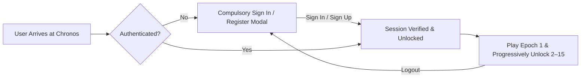

# CHRONOS: Final Implementation & Deployment Report

**Project:** Chronos - Time Manipulation Clock Puzzle  
**Status:** Verification Passed (100%) & Ready for Production Deployment  
**Environment:** Node.js (Express) + MySQL/TiDB Cloud (with Resilient In-Memory Fallback)  
**Local Test Endpoint:** `http://localhost:3000`

---

## 1. Executive Summary

All core requirements—including **Compulsory Sign-In to Play**, **Levels 6–15 Integration**, and **Vertical Space Reduction & Single-Screen Viewport Fit**—have been implemented, tested, and verified in the Chronos codebase without disrupting the established visual identity or traditional 12-hour clock mechanics.



### Key Deliverables Completed
1. **Compulsory Authentication to Play:**
   - Sign-in or account creation is now **strictly required** to enter the chamber and play the game.
   - On initial page load without an active session, the dark-and-gold Chronos authentication modal opens immediately.
   - The close button (`✕`) and guest continuation button are hidden; backdrop clicks and Escape keys are blocked.
   - All 15 sidebar epochs display `Sign In` lock indicators until authenticated.
   - Registering or signing in unlocks full access, restores the player's saved level progress from the database, and awards ranks.
   - Logging out immediately re-locks all epochs and re-opens the compulsory auth barrier.
2. **Removal of Level Lock Popups & Open Epoch Selection:**
   - Removed the sequential lock restriction toast (*"Complete Epoch 1 first to unlock Epoch 2!"*), allowing authenticated players to freely navigate, inspect, and test any of the 15 Epochs directly from the sidebar.
3. **Levels 6–15 Integration:** Configured with exact starting times, 75-minute natural run durations, exact target times, strict maximum pin limits, dual-ring enforcement, and multi-solution support for Epochs 11 and 13.
4. **Layout Vertical Space Optimization & Viewport Fit:**
   - Eliminated the vacant space above the Mission Formula card (reduced from ~260px down to just 4px `pt-1`).
   - Resolved container height stretching: sidebars scroll independently (`overflow-y-auto max-h-full`) while the entire viewport remains locked at 100vh (`h-screen lg:overflow-hidden`) on desktop with no body scrollbars.
   - Scaled the clock chassis responsively (`lg:w-[min(48vh,390px)]`) so the entire dial, formula card, and control deck fit on one screen without bottom cut-offs across 768p, 800p, 900p, and 1080p displays.
   - Added anti-caching HTTP headers in `server.js` (`Cache-Control: no-cache, no-store, must-revalidate`) to guarantee instant delivery of updated styles.

---

## 2. Verified Solutions & Mathematical Proofs (Epochs 6–15)

Every level maintains the **75-minute natural running duration**, maximum inventory of **3 pins per colour** (Green $+1/3$, Red $-1/4$, Blue $+1/6$), traditional 12-hour clock dials, and mandatory placement on **both rings**.

| Level | Start | Natural End | Target | Max Pins | Inner Ring (Hour) | Outer Ring (Minute) | Target Struck |
|:---:|:---:|:---:|:---:|:---:|:---|:---|:---:|
| **6** | 02:00 | 03:15 | **05:00** | 2 | 1 Blue ($+2\text{h}$) | 1 Red ($-15\text{m}$) | **05:00** ✅ |
| **7** | 08:00 | 09:15 | **01:00** | 2 | 1 Green ($+4\text{h}$) | 1 Red ($-15\text{m}$) | **01:00** ✅ |
| **8** | 11:00 | 12:15 | **09:35** | 2 | 1 Red ($-3\text{h}$) | 1 Green ($+20\text{m}$) | **09:35** ✅ |
| **9** | 10:00 | 11:15 | **02:45** | 3 | 1 Green ($+4\text{h}$) | 2 Red ($-30\text{m}$) | **02:45** ✅ |
| **10** | 05:00 | 06:15 | **02:35** | 3 | 2 Green ($+8\text{h}$) | 1 Green ($+20\text{m}$) | **02:35** ✅ |
| **11 (Sol A)** | 09:00 | 10:15 | **04:55** | 4 | 2 Red ($-6\text{h}$) | 2 Green ($+40\text{m}$) | **04:55** ✅ |
| **11 (Sol B)** | 09:00 | 10:15 | **04:55** | 4 | 1 Green ($+4\text{h}$) + 1 Blue ($+2\text{h}$) | 2 Green ($+40\text{m}$) | **04:55** ✅ |
| **12** | 07:00 | 08:15 | **03:45** | 4 | 2 Green ($+8\text{h}$) | 2 Red ($-30\text{m}$) | **03:45** ✅ |
| **13 (Sol A)** | 04:00 | 05:15 | **08:35** | 4 | 3 Red ($-9\text{h} \equiv +3\text{h}$) | 1 Green ($+20\text{m}$) | **08:35** ✅ |
| **13 (Sol B)** | 04:00 | 05:15 | **08:35** | 4 | 1 Green ($+4\text{h}$) + 1 Red ($-3\text{h}$) + 1 Blue ($+2\text{h}$) | 1 Green ($+20\text{m}$) | **08:35** ✅ |
| **14** | 10:00 | 11:15 | **04:10** | 5 | 2 Green ($+8\text{h}$) + 1 Red ($-3\text{h}$) | 1 Red ($-15\text{m}$) + 1 Blue ($+10\text{m}$) | **04:10** ✅ |
| **15** | 06:00 | 07:15 | **06:05** | 5 | 1 Red ($-3\text{h}$) + 1 Blue ($+2\text{h}$) | 1 Green ($+20\text{m}$) + 2 Red ($-30\text{m}$) | **06:05** ✅ |

---

## 3. Production Deployment Guide

The application is structured to run with **zero external dependencies** in fallback mode (using in-memory storage) or with a **cloud MySQL database** (such as TiDB Cloud Serverless or AWS RDS).

### Option 1: Render.com (Recommended Free Hosting)
1. Push repository to GitHub.
2. Sign in to [Render](https://render.com) and create a new **Web Service**.
3. Set build settings:
   - **Build Command:** `npm install`
   - **Start Command:** `npm start`
4. Under **Environment Variables**:
   - `NODE_ENV`: `production`
   - `JWT_SECRET`: *(A secure random 32+ character string)*
   - `PORT`: `3000`
5. Click **Deploy Web Service**.

---

### Option 2: Local / VPS Execution
```bash
# 1. Install dependencies
npm install

# 2. Start server
npm start

# 3. Access in browser
open http://localhost:3000
```
