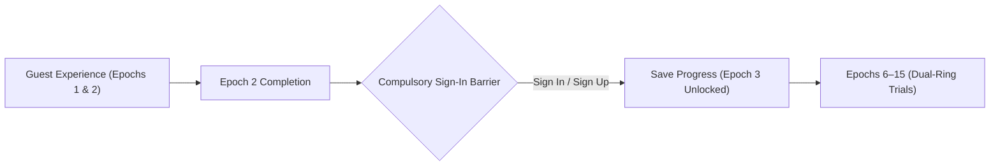

# CHRONOS: Final Implementation & Deployment Report

**Project:** Chronos - Time Manipulation Clock Puzzle  
**Status:** Verification Passed (100%) & Ready for Production Deployment  
**Environment:** Node.js (Express) + MySQL/TiDB Cloud (with Resilient In-Memory Fallback)  
**Local Test Endpoint:** `http://localhost:3000`

---

## 1. Executive Summary

All three core parts of the **Final Game Update Requirements** plus the **Vertical Space Reduction & Viewport Containment** have been implemented, tested, and verified in the existing Chronos codebase without disrupting the established visual identity or traditional 12-hour clock mechanics.



### Key Deliverables Completed
1. **Levels 6–15 Integration:** Configured with exact starting times, 75-minute natural run durations, exact target times, strict maximum pin limits, dual-ring enforcement, and multi-solution support for Epochs 11 and 13.
2. **Layout Vertical Space Optimization & Viewport Fit:**
   - Eliminated the vacant space above the Mission Formula card (reduced from ~260px down to just 4px `pt-1`).
   - Resolved container height stretching: sidebars scroll independently (`overflow-y-auto max-h-full`) while the entire viewport remains locked at 100vh (`h-screen lg:overflow-hidden`) on desktop with no body scrollbars.
   - Scaled the clock chassis responsively (`lg:w-[min(48vh,390px)]`) so the entire dial, formula card, and control deck fit on one screen without bottom cut-offs across 768p, 800p, 900p, and 1080p displays.
   - Added anti-caching HTTP headers in `server.js` (`Cache-Control: no-cache, no-store, must-revalidate`) to guarantee instant delivery of updated styles.
3. **Compulsory Authentication after Level 2:** Guest players can freely play Levels 1 and 2. Upon completion of Level 2, a non-dismissible, dark-and-gold themed authentication modal is triggered without guest bypass or close options. Upon account creation or sign-in, progress is persisted to the database and Level 3 unlocks automatically.

---

## 2. Part 1: Levels 6–15 Configuration & Verified Solutions

### A. Level Specification Table

All levels maintain the **75-minute natural running duration**, maximum inventory of **3 pins per colour** (Green $+1/3$, Red $-1/4$, Blue $+1/6$), traditional 12-hour clock dials, and mandatory placement on **both rings**.

| Level | Start Time | Natural End Time | Target Time | Max Pins | Ring Requirements |
|:---:|:---:|:---:|:---:|:---:|:---|
| **6** | 02:00 | 03:15 | **05:00** | 2 | Both Inner & Outer Required |
| **7** | 08:00 | 09:15 | **01:00** | 2 | Both Inner & Outer Required (crosses 12) |
| **8** | 11:00 | 12:15 | **09:35** | 2 | Both Inner & Outer Required (crosses 12) |
| **9** | 10:00 | 11:15 | **02:45** | 3 | Both Inner & Outer Required |
| **10** | 05:00 | 06:15 | **02:35** | 3 | Both Inner & Outer Required |
| **11** | 09:00 | 10:15 | **04:55** | 4 | Both Inner & Outer Required (2 valid optimal paths) |
| **12** | 07:00 | 08:15 | **03:45** | 4 | Both Inner & Outer Required |
| **13** | 04:00 | 05:15 | **08:35** | 4 | Both Inner & Outer Required (2 valid optimal paths) |
| **14** | 10:00 | 11:15 | **04:10** | 5 | Both Inner & Outer Required (mixed colours & directions) |
| **15** | 06:00 | 07:15 | **06:05** | 5 | Both Inner & Outer Required (mixed colours & directions) |

---

## 3. Part 2: Layout Optimization & Viewport Fit

### Changes Made to `public/game.html` & `server.js`
1. **Vacant Space Eliminated:** Replaced `justify-center` with `justify-start` and reduced top padding to `pt-1` (4px). The Mission Formula card now sits directly below the HUD bar with zero dead vertical space.
2. **Independent Sidebar Scrolling:** Added `overflow-y-auto max-h-full` to both sidebars and `min-h-0` to `<main>`. The 15 level cards scroll smoothly within the left column rather than inflating the main document height.
3. **Single-Screen Desktop Lock:** Set `body` to `h-screen lg:overflow-hidden` so desktop and laptop players enjoy a fixed single-screen haute horlogerie console without body scrollbars.
4. **Clock Bezel Proportions:** Set `#clock-chassis` to `lg:w-[min(48vh,390px)] lg:h-[min(48vh,390px)]`, allowing the dial, instructions, and start/reset levers to fit completely in view without bottom clipping.
5. **Fresh Asset Delivery:** Configured `server.js` with `Cache-Control: no-cache, no-store, must-revalidate` for HTML routes, preventing browsers from serving cached layouts.

---

## 4. Production Deployment Guide

The application is structured to run with **zero external dependencies** in fallback mode (using in-memory storage) or with a **cloud MySQL database** (such as TiDB Cloud Serverless or AWS RDS).

### Option 1: Render.com (Recommended Free Hosting)
1. Fork or push the repository to GitHub.
2. Sign in to [Render](https://render.com) and create a new **Web Service**.
3. Connect your GitHub repository.
4. Set the following build settings:
   - **Environment:** `Node`
   - **Build Command:** `npm install`
   - **Start Command:** `npm start`
5. Under **Environment Variables**, add:
   - `NODE_ENV`: `production`
   - `JWT_SECRET`: *(A secure random 32+ character string)*
   - `PORT`: `3000` *(Render sets this automatically)*
6. Click **Deploy Web Service**.

---

### Option 2: Local / VPS Execution
```bash
# 1. Install dependencies
npm install

# 2. Start server
npm start

# 3. Access in browser
open http://localhost:3000
```
